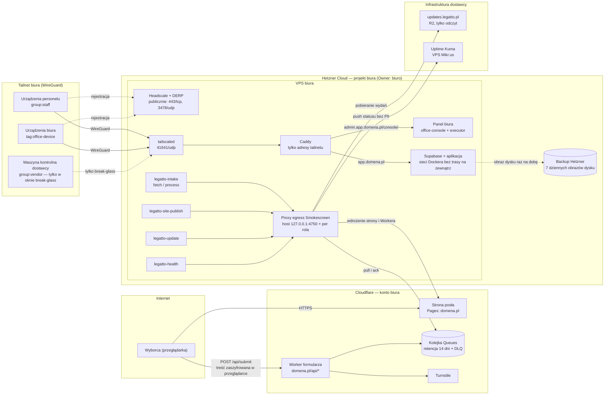
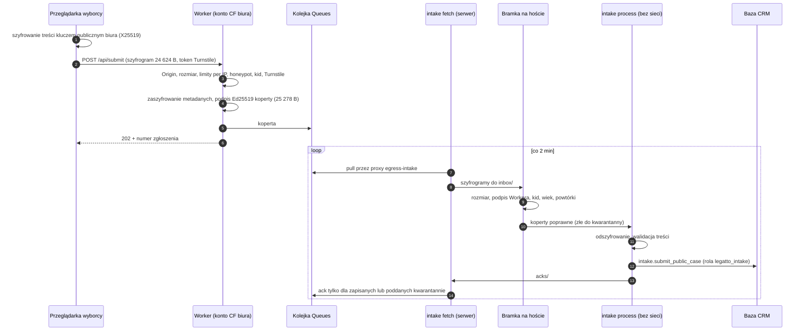
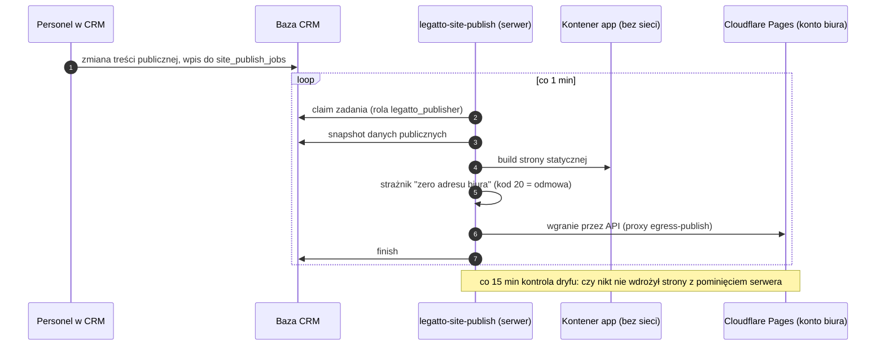
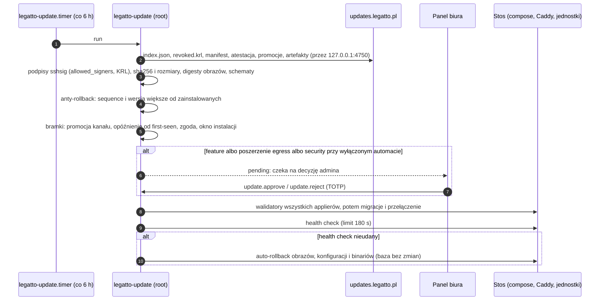
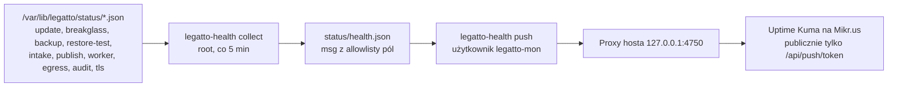
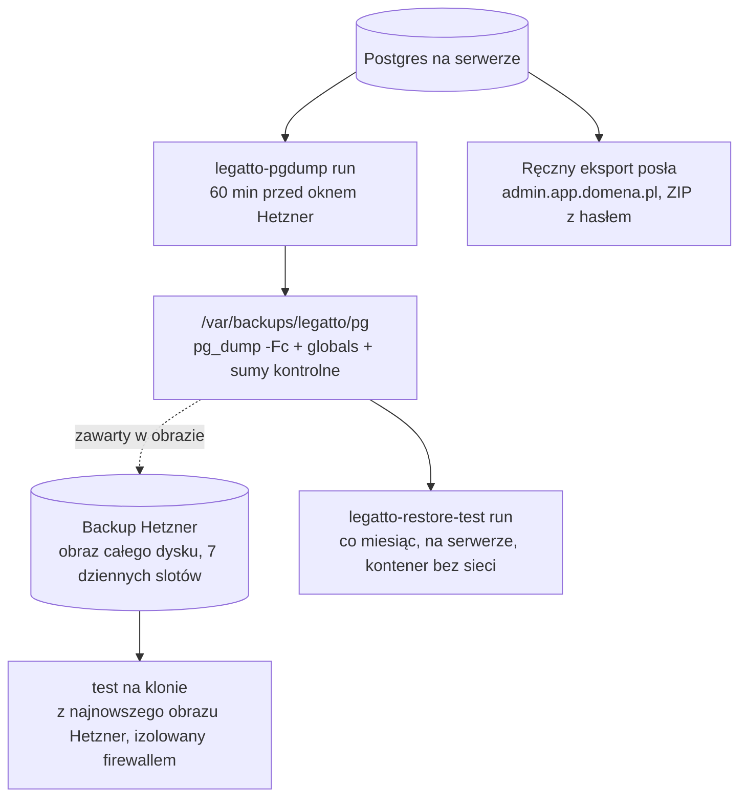
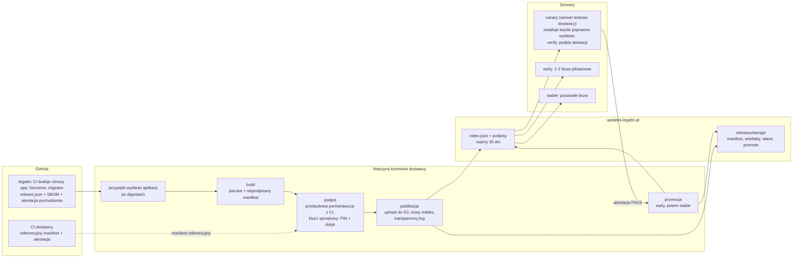
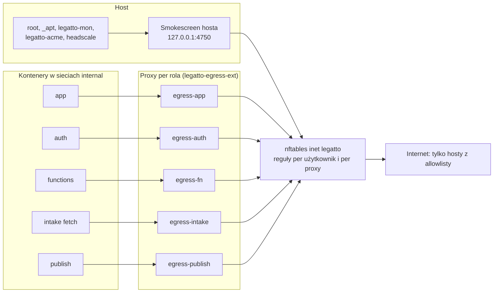
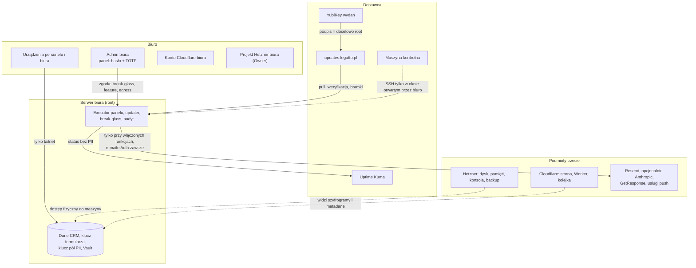

# Architektura serwera biura Legatto

Ten dokument opisuje, jak zbudowana jest instalacja Legatto dla jednego biura poselskiego: co działa na serwerze, co poza nim, którędy płyną dane i gdzie przebiegają granice zaufania. Nazwy, porty i ścieżki pochodzą z kontraktu `contract/contract.yml`; jeśli tu coś się z nim nie zgadza, wygrywa kontrakt.

Oznaczenie **[VPS]** przy twierdzeniu znaczy: zachowanie sprawdzone tylko testami na atrapach, do potwierdzenia na prawdziwym serwerze.

## 1. Składniki w skrócie

| Gdzie | Co | Właściciel konta |
|---|---|---|
| Hetzner Cloud, projekt biura | jeden VPS (Ubuntu 24.04, amd64): Headscale, Caddy, Supabase, aplikacja, panel biura, updater, proxy egress | biuro (Owner projektu; dostawca bez stałej roli) |
| Cloudflare, konto biura | strefa DNS domeny posła, strona posła (Pages), Worker formularza, kolejka zgłoszeń (Queues), Turnstile | biuro |
| Cloudflare, konto dostawcy | hosting wydań `updates.legatto.pl` (R2, tylko odczyt publicznie) | dostawca |
| VPS dostawcy | globalna instancja Uptime Kuma (monitoring push, bez danych osobowych) | dostawca |
| Maszyna kontrolna dostawcy | wdrożenie i prace serwisowe w oknie break-glass, podpis wydań kluczem sprzętowym | dostawca |
| GitHub | `legatto-node` (to repozytorium, publiczne), `legatto` (aplikacja, publiczne); narzędzia wdrożeniowe i inwentarze biur dostawcy są prywatne | dostawca |

Nazwy hostów biura:

| Nazwa | Co | Gdzie widoczna |
|---|---|---|
| `<domena>` | strona posła (Cloudflare Pages) + Worker na `<domena>/api/*` | publicznie |
| `vpn.<domena>` | Headscale (koordynator tailnetu) | publicznie — jedyny publiczny rekord serwera (A, bez proxy Cloudflare) |
| `app.<domena>` | CRM | tylko MagicDNS w tailnecie, adres IPv4 tailnetu serwera |
| `admin.app.<domena>` | panel biura (`/console/`) i funkcje wrażliwe aplikacji | tylko MagicDNS, adres IPv6 tailnetu serwera |
| `studio.app.<domena>` | Supabase Studio, tylko na żądanie | tylko MagicDNS, adres IPv6 tailnetu serwera |

Certyfikat `app.<domena>` + `*.app.<domena>` wystawia Let's Encrypt przez DNS-01 (lego, token Cloudflare ograniczony do strefy biura). Headscale ma własny certyfikat dla `vpn.<domena>` przez TLS-ALPN-01. Rekordy CAA: `vpn.` tylko `tls-alpn-01`, `app.` tylko `dns-01`.

## 2. Schemat całości

Z internetu na serwerze widać tylko Headscale: `443/tcp` (HTTPS i DERP), `3478/udp` (STUN) i `41641/udp` (WireGuard). CRM, panel i SSH słuchają wyłącznie na adresach tailnetu. Dostawca sprawdza to skanem `nmap` z zewnątrz po każdym wdrożeniu.

## 3. Serwer biura

### 3.1 Sieć i dostęp

- **Firewall:** własna tabela nftables `inet legatto` z polityką drop. Nie korzysta z łańcucha `DOCKER-USER`; Docker zostaje przy backendzie iptables. Każda podmiana reguł idzie przez `legatto-fw-apply` z automatycznym wycofaniem po 120 s, jeśli nowe połączenie jej nie potwierdzi.
- **Tailnet:** Headscale 0.29.7 na tym samym serwerze, własny DERP, MagicDNS w domenie `tn.<domena>`. Serwer jest węzłem z tagiem `tag:server`. Rejestracja urządzeń wyłącznie jednorazowymi kluczami pre-auth (ważność 30 min) z panelu biura. Rejestracja urządzenia wygasa po 180 dniach (`legatto_node_expiry`).
- **Polityka ACL** (`headscale/acl.hujson.j2`, renderowana na serwerze przez `legatto-policy`):
  - `group:staff` → `app` (IPv4 serwera, `tcp/443`);
  - `tag:office-device` → `app` i `admin` (IPv6 serwera, `tcp/443`);
  - `group:vendor` → SSH (`tcp/22`) i `admin` **tylko w wariancie break-glass**;
  - `tag:server` nigdy nie jest źródłem; brak ruchu między użytkownikami.
- **SSH:** OpenSSH tylko na `legatto_ts_ip4:22`, tylko klucze `sk-ssh-ed25519` kont `v-<imię>` z grupy `legatto-ops`. Poza oknem break-glass dostawcę odcinają dwie niezależne warstwy: polityka Headscale i sety nftables (`vendor4/6`, `bg4/6`).
- **Konto `recovery`:** hasło powstaje na serwerze, logowanie wyłącznie na konsoli VPS (pam_access), `sudo` z hasłem. Hasło trafia tylko do pakietu odzyskiwania.
- **Break-glass:** okno 1–8 h otwierane przez admina biura w panelu (`breakglass.enable`). Reconcile co minutę zamyka okno po czasie, zrywa sesje i zapisuje podsumowanie (logowania SSH, polecenia sudo, uruchomienia Ansible).

### 3.2 Usługi

| Warstwa | Składniki | Uwagi |
|---|---|---|
| Wejście | Caddy (`legatto-caddy`), lego (`legatto-acme`) | Caddy słucha na `ts_ip4:443` (crm) i `[ts_ip6]:443` (admin, studio); ścieżki `admin-*`, `/api/admin*`, `/api/export*` zwracają 404 na `app.` |
| Aplikacja | Supabase self-hosted v0.8.4 (bez imgproxy, poolera, analytics), gateway `api-gw` (Envoy), obrazy `app`, `functions`, `migrator` | obrazy po digest z paczki; `app` read-only, `cap_drop ALL`, uid 65532 |
| Panel biura | `legatto-console` (bez uprawnień, gniazdo unix) + `legatto-console-exec` (root, spool żądań) | logowanie: hasło (scrypt) w panelu, TOTP sprawdza executor, więc przejęcie samego panelu nie wystarcza |
| Formularz | `legatto-intake fetch` (sieć, token kolejki, bez klucza i bazy), `legatto-intake process` (klucz X25519 i baza, bez sieci) | timer co 2 min |
| Strona | `legatto-site-publish` (timer co 1 min szuka zadań publikacji), `legatto-worker-deploy` | build bez sieci, strażnik „zero adresu biura" |
| Aktualizacje | `legatto-update` (timer co 6 h ± 30 min) | §5 |
| Monitoring | `legatto-health` (co 5 min) | §4.4 |
| Backup | `legatto-pgdump` (przed oknem backupu Hetzner), `legatto-restore-test` (pierwsza niedziela miesiąca, 11:00 UTC) | §4.5 |
| Audyt | `legatto-audit` — jedyny zapisujący `/var/log/legatto/audit.log` (JSONL z łańcuchem hashy, `chattr +a`) | weryfikacja co 5 min, kotwica łańcucha w Kuma |

### 3.3 Sieci Dockera

| Sieć | Typ | Kto |
|---|---|---|
| `legatto-host` (`br-legatto`, `172.30.0.0/24`) | bridge, DNS kontenerów = `172.30.0.53` (adres, pod którym nic nie odpowiada) | db `.2`, app `.10`, api-gw `.11` |
| `legatto-int` | `internal` (bez trasy na zewnątrz) | komunikacja usług stosu |
| `legatto-egress-<rola>` (`app`, `auth`, `fn`, `intake`, `publish`) | `internal` | kontener roli ↔ jego proxy `egress-<rola>:4750` |
| `legatto-egress-ext` (`172.30.255.0/24`) | bridge | tylko kontenery proxy egress |

Daemon Dockera: `"bridge":"none"`, porty tylko na `127.0.0.1`, `no-new-privileges`, logi do journald.

## 4. Przepływy danych

### 4.1 Formularz kontaktowy na stronie posła

- Treść formularza szyfruje przeglądarka. Worker widzi tylko szyfrogram i metadane techniczne; nie widzi treści, chyba że ktoś czynnie podmieni skrypt strony (`docs/SECURITY.md` §4).
- Proces, który widzi tekst jawny (`process`), nie ma żadnej sieci; proces z siecią (`fetch`) nie ma klucza ani bazy.
- Kolejka trzyma zgłoszenia 14 dni, więc przerwa serwera do kilku dni nie gubi zgłoszeń.

### 4.2 Publikacja strony posła

Worker wdraża `legatto-worker-deploy`, wywoływany przez updater po zielonym health checku wydania z artefaktem `worker-bundle`; przy nieudanym self-teście wycofuje wersję w Cloudflare (kod 60). Dostawca nie ma członkostwa w koncie Cloudflare biura; tokeny biura (Queues, Pages/Workers, DNS-01) tworzy na serwerze `legatto-cf-bootstrap` z jednorazowego tokenu wpisanego przez biuro i trzyma w `/etc/credstore.encrypted/`.

### 4.3 Aktualizacja (pull)

Szczegóły łańcucha wydań: §5.

### 4.4 Monitoring

- Payload Kuma składa się wyłącznie z pól `legatto_kuma_fields` (wersja, kanał, wynik podpisu, wiek sprawdzenia, stan aktualizacji, dysk, RAM, backup, test odtworzenia, liczba błędów, kontenery, break-glass, kotwica audytu, certyfikat, egress, liczniki formularza). Wartość niepasująca do wyrażenia z kontraktu zamienia się na `ERR`. Treść logów nie jest czytana, liczona jest tylko liczba wpisów o priorytecie 0–3.
- `status=down`, gdy m.in.: zły podpis wydania, nieudana instalacja lub rollback, brak udanego sprawdzenia wydań od ponad 24 h, kontener unhealthy, dump starszy niż 26 h, dysk > 90 %, kolejka formularza nieodebrana > 15 min, certyfikat < 14 dni, łańcuch audytu uszkodzony.
- Kuma działa na VPS dostawcy, za Caddy, który przepuszcza publicznie tylko `/api/push/<token>`. Dashboard jest dostępny tylko przez tunel SSH.

### 4.5 Backup

- **Jedyną kopią poza serwerem jest backup Hetzner** w projekcie biura. Włącza go biuro jako Owner; okno backupu wpisuje się do inwentarza (`legatto_hetzner_backup_window`). Bez tego wpisu monitoring pokazuje `bk=none` i `down`.
- Dump bazy powstaje transakcyjnie przed oknem, więc obraz dysku zawiera spójną kopię bazy nawet wtedy, gdy pliki Postgresa w obrazie byłyby niespójne.
- Dowodem, że obrazy Hetzner istnieją i dają się odtworzyć, jest test na klonie (`restore-test.json`: `mode=hetzner`). Klon dostaje firewall Hetznera bez ruchu wychodzącego, usługi wychodzące są zatrzymane przez cloud-init, a połączenie wymaga klucza hosta serwera biura.
- Ręczny eksport danych (A13 w `legatto-app`) to ZIP z hasłem (AES-256), dostępny tylko na `admin.app.<domena>` dla posła z 2FA; każdy eksport trafia do audytu aplikacji.
- Ryzyka przyjęte świadomie: `docs/SECURITY.md` §7.

## 5. Łańcuch wydań

Kroki:

1. **Wejście aplikacji.** CI repo `legatto` buduje obrazy i `release.json` (bez publikacji, bez sekretów). Narzędzie wydań dostawcy przypina to wydanie po digestach (podpisany commit) i odrzuca wydanie zbudowane z brudnego drzewa.
2. **Build**: z zatwierdzonej treści repozytoriów, `contract/versions.yml` i `bundle/**`. Przebudowuje obrazy aplikacji z przypiętego commita i wymaga identycznych digestów. Wynik: manifest zgodny ze schematem `release/schema/manifest.schema.json`, SBOM-y i allowlista egress w `manifest.egress`.
3. **Podpis**: przed dotknięciem klucza narzędzie sprawdza paczkę, porównuje ją z niezależnym buildem z CI (artefakt z weryfikowaną atestacją pochodzenia), pokazuje podsumowanie i diff względem poprzedniego wydania (w tym poszerzenia egress). Podpis: `ssh-keygen -Y sign -n legatto-release` kluczem `ed25519-sk` (PIN i dotyk).
4. **Publikacja**: artefakty jako obiekty niezmienne, potem podpisy, manifest, wpis do `transparency.log` (JSONL z łańcuchem hashy), podpisany `index.json`.
5. **Canary** instaluje każde poprawne wydanie i po testach akceptacyjnych podpisuje atestację programowym kluczem serwera canary (`legatto-update attest`, namespace `legatto-canary`).
6. **Promocja** do `early` i `stable`: wymaga atestacji `PASS` dla dokładnie tego manifestu; `stable` wymaga też ważnej promocji `early`. Dokument promocji i nowy indeks są podpisane kluczem sprzętowym.
7. **Pull i weryfikacja na serwerze** (§4.3): serwer liczy minimalne opóźnienie od chwili, w której **sam** pierwszy raz zobaczył promocję swojego kanału (`promoted_at` niczego nie przyspiesza):

| Typ | early | stable |
|---|---|---|
| `security` | ≥ 2 h | ≥ 4 h |
| `feature` | ≥ 24 h | ≥ 48 h |

   Wydanie `feature` zawsze czeka na zgodę admina biura w panelu. Każde poszerzenie allowlisty egress wstrzymuje całe wydanie do zgody, niezależnie od typu. `security` instaluje się samo w oknie instalacji (`legatto_install_window`), chyba że admin wyłączył automat. Skok zegara > 60 min blokuje instalację.

Klucze zaufania na serwerze (`/etc/legatto/update/allowed_signers`, `policy.json`, początkowy KRL) zmienia wyłącznie dostawca w oknie break-glass otwartym przez biuro. Wymagana liczba podpisów: `signatures_required` (dziś 1).

Publiczne klucze wydań: `trust/allowed_signers`. Dziś istnieje jeden klucz sprzętowy (`release-a`); zapasowy `release-b` zostanie dopisany po zakupie drugiego klucza. Bez klucza produkcyjnego w `trust/allowed_signers` serwer produkcyjny odmawia instalacji.

### 5.1 Co paczka może zmienić, a co tylko break-glass

| Przez paczkę (pull) | Tylko dostawca w oknie break-glass |
|---|---|
| obrazy, compose, strony Caddy (`sites.d`), jednostki `legatto-stack`, `legatto-cron*`, `legatto-secrets-render`, funkcje, migracje, binaria `caddy`/`lego`/`smokescreen`, pakiety `headscale`/`tailscale`, dane allowlisty egress, Worker | `allowed_signers`, `policy.json`, KRL startowy, polityka Headscale, nftables, sshd, sudoers, auditd, globalny Caddyfile, `legatto-acme`, jednostki i ACL bazowe proxy hosta, `office.env`, `pinned.json`, sekrety, sam updater i executor panelu |

Pakiety `.deb` i binaria działają jako root, więc podpis wydania jest docelowo równoważny rootowi. Typowane appliery chronią przed przypadkową zmianą granic i wymuszają jawność, nie przed złośliwym podpisującym. Uczciwy opis: `docs/SECURITY.md` §4.

## 6. Egress

- Kontenery nie mają trasy na zewnątrz (sieci `internal`); wychodzą tylko przez proxy swojej roli. Proxy roli z pustą listą działa, ale ma ACL odrzucający wszystko i brak reguły uplinku w nft.
- DNS kontenerów wskazuje adres, pod którym nic nie odpowiada; Caddy i panel mają odcięty lokalny resolver (`IPAddressDeny`, `InaccessiblePaths`) **[VPS]**. Adres metadanych `169.254.169.254` jest zawsze odcięty.
- Allowlista bazowa (`bundle/egress/base.yml`): host — `updates.legatto.pl`, `archive.ubuntu.com` i `security.ubuntu.com` (port 80), `download.docker.com`, `acme-v02.api.letsencrypt.org`, `api.cloudflare.com`; `app` — `api.resend.com` (e-maile Auth z domeny biura); `intake` i `publish` — `api.cloudflare.com`.
- Funkcje opcjonalne (`bundle/egress/features.yml`) otwierają ruch dopiero po włączeniu w panelu: `ai` (`api.anthropic.com`), `email` (`api.resend.com`), `getresponse`, `push` (usługi push producentów przeglądarek), `ics` (hosty wpisane przez biuro), `hibp` (`api.pwnedpasswords.com`, domyślnie włączone). `mcp` nie otwiera żadnego hosta.
- Wpisy przypięte (`pinned.json`, renderowane przez rolę `egress`, nigdy z paczki): serwer wydań, Kuma, repozytoria Ubuntu. Wydanie, które próbuje je usunąć, jest odrzucane (kod 41).
- Tryby: `observe` (loguje, nie blokuje; F2–F5) i `enforce` (blokuje; wymagany na produkcji). Tryb jest parametrem biura `legatto_egress_mode`.
- Ograniczenie: ACL Smokescreena nie filtruje portów, więc proxy hosta dopuszcza porty 80 i 443 dla wszystkich hostów roli host; zbiór portów ogranicza nft.

## 7. Granice zaufania

| Granica | Co jej pilnuje | Co jej nie chroni |
|---|---|---|
| Internet → serwer | 3 porty publiczne, wszystko inne w tailnecie | błąd w Headscale/tailscaled |
| Personel → CRM | ACL Headscale, logowanie w aplikacji | zainfekowane urządzenie z ważną sesją (`docs/SECURITY.md` §4) |
| Dostawca → serwer | okno break-glass (polityka + sety nft + wygaśnięcie), audyt z łańcuchem hashy | w oknie dostawca ma roota |
| Dostawca → serwer przez wydania | podpis sprzętowy, canary, promocja, opóźnienia, zgoda na feature i egress, jawny `transparency.log` | podpisane wydanie jest docelowo równoważne rootowi |
| Cloudflare → treść formularza | szyfrowanie w przeglądarce | czynna podmiana skryptu strony lub Workera |
| Hetzner → dane | — | dostawca VPS ma dysk, pamięć i kopie (`docs/SECURITY.md` §4) |
| Serwer → internet | proxy z allowlistą nazw, nft per użytkownik | usługi wielodostępne na allowliście są kanałem wycieku (`docs/SECURITY.md` §4) |

Pełny model zaufania i akceptowane ryzyka: `docs/SECURITY.md`.

## 8. Repozytoria i odpowiedzialność

- `legatto-node` (to repozytorium, publiczne, AGPL-3.0-only): wszystko, co działa na serwerze biura albo decyduje, co dostawca może — updater, panel biura, narzędzia hosta (break-glass, ACL, audyt, egress, monitoring, backup), paczka (compose, Caddy, systemd), Worker formularza, schematy wydań, kontrakt, publiczne klucze wydań.
- `legatto` (aplikacja, publiczne, AGPL-3.0-only): kod CRM, intake, generator strony, obrazy `app`/`functions`/`migrator`.
- Narzędzia wdrożeniowe dostawcy (playbooki, budowanie i publikacja wydań) oraz inwentarze biur są prywatne. Nie zmieniają tego, co serwer przyjmie: o tym decyduje kod z tego repozytorium.
